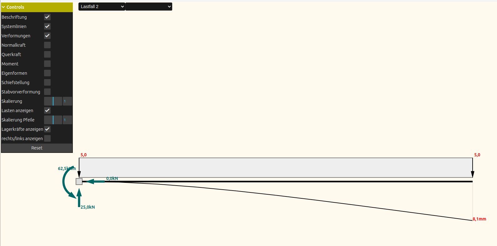

# Information

This is a simple 2D frame analysis app. It can solve linear elastic systems on your smart phone, tablet or PC. It supports a mouse, but can also be used entirely with a finger on a smart phone or tablet.

## Features

- CAD like Grafical input for mouse, pen or finger
- Timoshenko and Bernoulli beam theory
- first and second order analysis
- pre-deformations, imperfections
- eigenvalues, critical load, &alpha;<sub>cr</sub>
- line loads, nodal loads, temperature, and more
- load cases and combinations with (safety) factors



## Try it

You can try the current test version at https://d2beam-gui.netlify.app 😊.

## Languages and translations

The app is available in German (source language), English, Spanish, French and Italian.

| Language | Status |
|---|---|
| German (`de`) | source language |
| English (`en-GB`) | reviewed |
| Spanish (`es-ES`) | not yet reviewed by a native speaker |
| French (`fr-FR`) | not yet reviewed by a native speaker |
| Italian (`it-IT`) | not yet reviewed by a native speaker |

Help from native speakers with a background in structural engineering is very welcome, for example civil engineering students. Corrections of single terms are just as helpful as a full review.

### Where the texts are

- **App texts:** `xliff/<locale>.xlf`. Each `<trans-unit>` contains the German `<source>` and the translated `<target>`. Use the English file for comparison.
- **Short documentation (Info tab):** `public/Kurzdokumentation_<language>.html`

Terms that need particular attention in French and Italian are, for example: *Schiefstellung* (global imperfection), *kinematisch* (mechanism), *Bettung* (elastic foundation, Winkler) and *Vorspannung* (prestress).

### Workflow

```bash
npx lit-localize extract   # after code changes: adds new texts to xliff/*.xlf
# edit the <target> entries in xliff/<locale>.xlf
npx lit-localize build     # generates src/generated/locales/*.ts
```

Please send corrections as a pull request or by e-mail to statikverstehen&#x40;web.de.
